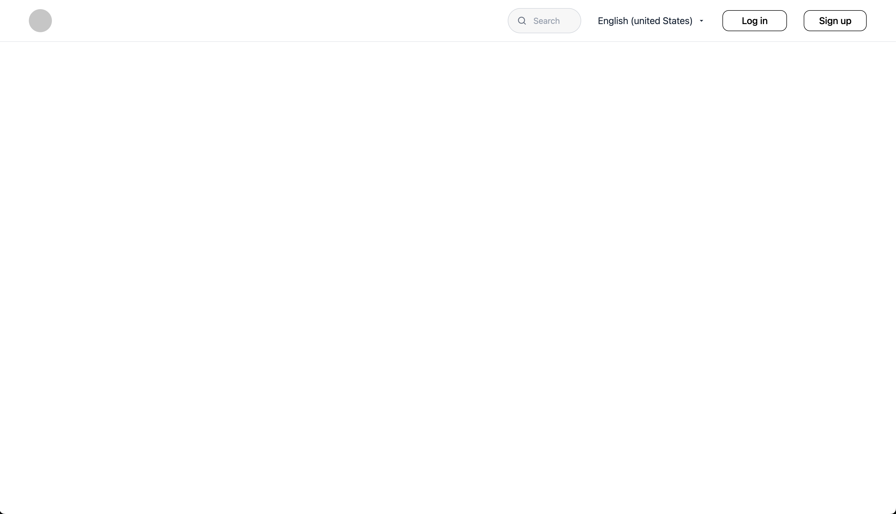
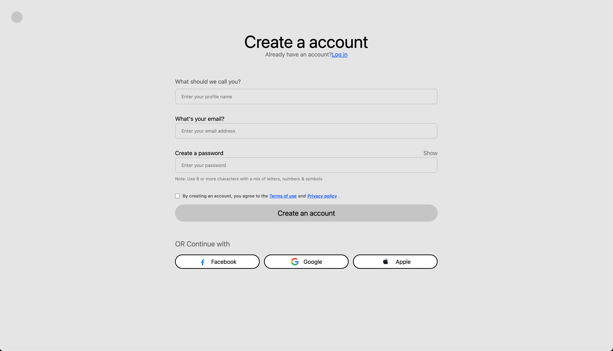
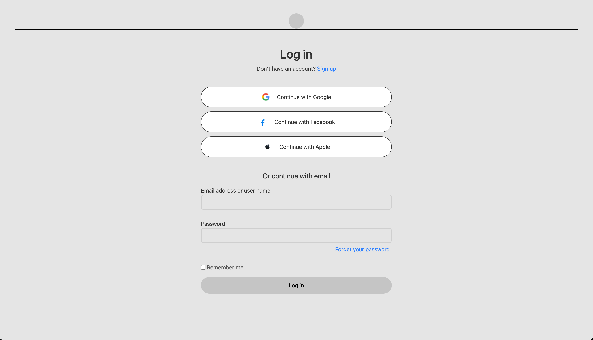

# Account Page

It is a simple Account page.

## Getting Started

This is an example of how you may give instructions on setting up your project locally.
To get a local copy up and running follow these simple example steps.

## Installation

1. Clone the repo
    ```sh
    git clone https://github.com/ayushks05/Account-page.git
    ```
2. Install NPM packages
    ```sh
    npm i
    ```
3. Change git remote url to avoid accidental pushes to base project
    ```sh
    git remote set-url origin github_username/repo_name
    git remote -v # confirm the changes
    ```

## Screenshots

### Home Page



### Signup Page



### Login Page



## Contributing

Contributions are what make the open source community such an amazing place to learn, inspire, and create. Any contributions you make are **greatly appreciated**.

If you have a suggestion that would make this better, please fork the repo and create a pull request. You can also simply open an issue with the tag "enhancement".
Don't forget to give the project a star! Thanks again!

1. Fork the Project
2. Create your Feature Branch (`git checkout -b feature/AmazingFeature`)
3. Commit your Changes (`git commit -m 'Add some AmazingFeature'`)
4. Push to the Branch (`git push origin feature/AmazingFeature`)
5. Open a Pull Request

## Contact

Your Name - [@aayeoshh](https://twitter.com/aayeoshh) - ayushks.work07@gmail.com

Project Link: [https://github.com/ayushks05/Account-page](https://github.com/ayushks05/Account-page)